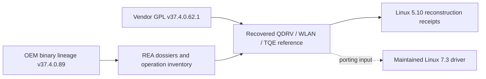

# HGW500 Quantenna driver reverse engineering

> Public source snapshot. [Scope, provenance and verification](docs/PUBLIC_SNAPSHOT.md).

This repository preserves the Quantenna host-driver reference and readable reverse-engineering dossiers. It connects available vendor GPL source to observed OEM operations, while keeping recovered C, assembly and synthetic analysis views distinguishable.

## How this component fits



This diagram shows software ownership and analysis flow, not a complete board schematic.
The [system architecture](docs/SYSTEM_ARCHITECTURE.md) explains the ARC750 host,
MuC, AuC, DSP and Realtek 8051, with their memory and firmware boundaries.

## What is established

| Area | Recorded scope |
| --- | --- |
| Source lineage | The available GPL release is v37.4.0.62.1; the documented OEM binary lineage is v37.4.0.89. The difference is an explicit source gap. |
| Readable dossiers | Eight retained REA dossiers cover selected QDRV/WLAN operations and TQE transmit behavior; they are not a decompilation of the entire firmware. |
| Baseline | Historical QDRV/WLAN static equivalence and TQE byte-identical reconstruction concern the recorded Linux 5.10 reference. |
| Address model | Some subjects use synthetic analysis addresses; those ELFs are analysis artifacts, not executable firmware images. |

## Start reading here

1. [Component handoff](docs/PROJECT_HANDOFF.md): inputs, evidence and next work.
2. [System architecture](docs/SYSTEM_ARCHITECTURE.md): processors and firmware families.
3. [Firmware contents](docs/FIRMWARE_MAP.md): OEM, Core Boot R1 and API v2 R3.
4. [Repository map](docs/REPOSITORY_MAP.md): host drivers, payloads and integration.
5. [Published checkout availability](docs/CHECKOUT_AVAILABILITY.md): actual remote source inventory.
6. [Preserved technical notes](docs/REFERENCE_NOTES.md): detailed earlier results, with workstation paths normalized.

## Work in progress

Close OEM/GPL extension gaps, types and indirect calls using the original subject and its instruction bytes. Keep Linux 5.10 reconstruction claims out of Linux 7.3 physical acceptance.

## Offline verification


```sh
python tools/verify_public_export.py
```

This checks the published file inventory. Original preservation verifiers and
receipts describe the private source checkpoint; they can require omitted native
databases or external inputs and are not a fresh public-snapshot qualification.

## Preservation and scope

This is a public source snapshot; per-unit data and original private histories remain private. Original vendor/GPL source, notices, comments,
carriers and immutable evidence retain their authorship and provenance. Derived
C is labelled as inferred analysis, not silently presented as original source.
Credentials, unit identity, calibration, personalized rootfs/flash images and
workstation-specific configuration stay outside documentation exports.

Documentation prepared 2026-11-10 from recorded source/evidence. No device access,
firmware installation, radio change or new physical qualification is implied.
